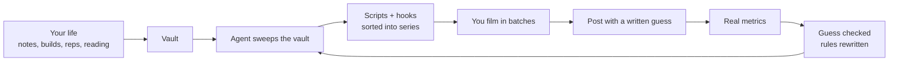

# The Content Loop

An AI content agent that turns your life into a never-empty queue of ready-to-film videos, then learns from every post.

Built by Ethan Leeds (@theleedsmethod). I got tired of forgetting ideas and posting on vibes. So I built a loop: everything I do gets written into a vault, an agent reads it every week, turns it into scripts, predicts how each post will do, checks the prediction against real numbers, and rewrites its own rules.

My content stopped running out because my life stopped running out.

## What it does



Every week it:

0. **Applies your feedback.** Approvals, rejections and their reasons, before anything else.
1. **Closes last week's guesses.** Every post went out with a one-line prediction. It pulls the real number and marks each one right or wrong.
2. **Reads performance.** Ranked by rate (saves + shares per 1,000 views), never by raw views.
3. **Runs the three-way read.** What you lived vs what you posted vs what performed.
   - Lived it, didn't post it: free content
   - Posted it, it flopped: cut it back
   - It performs, you don't do enough of it: do more of it in real life
4. **Checks your Value Brief**, your own words on what you want the channel to do.
5. **Refills the queue** to a week of ready-to-film videos, each with a spoken hook, a setup checklist, its cuts, and a guess.
6. **Writes full scripts** that connect what you read or learned to real decisions you made.
7. **Updates the Series Map and the board**, grouped into batch shoots.
8. **Recalibrates.** Once enough guesses are checked, it rewrites its own rules based on what actually predicted results for your audience.

## Why it's a loop and not a list

An idea bank is memory. It remembers. A loop learns. The difference is the guess: every post carries a prediction written before it goes out, and the checked result corrects the next round. Post 21 times a week and you run 21 experiments, not 21 repeats.

This maps to a simple ladder of AI use:

| Level | What the AI owns | In this repo |
|---|---|---|
| L1 Prompting | nothing | asking ChatGPT for video ideas |
| L2 Tasks | one repeatable job | "write me a hook" |
| L3 Systems | runs without you | the weekly scheduled run |
| L4 Memory | works from your context | the vault |
| L5 Learning | improves from outcomes | the guess, the check, the rewrite |
| L6 Autonomy | plans the how toward your what | the agent choosing what to spec, you choosing the channel's purpose |

Most creators are at L1. This repo is L5.

## What you need

- [Claude Code](https://docs.claude.com/en/docs/claude-code/overview) (runs the agent)
- A folder of markdown files. Obsidian is great for this but optional
- Optional: [Metricool](https://metricool.com) connected as an MCP server for real Instagram/TikTok numbers. Without it, you paste your numbers into the ledger and the loop still works

## Setup (15 minutes)

1. **Clone it.**
   ```
   git clone <this repo> my-content-loop
   cd my-content-loop
   ```
2. **Fill in three files in `vault/`.** This is the only part that has to be you.
   - `Channel.md`: who you help, your pillars, your craft rules
   - `Value-Brief.md`: in your own words, what you want your content to do
   - `Life/README.md`: where your life gets written down (see below)
3. **Start writing your life into `vault/Life/`.** Anything: a lift PR, a book note, a sales call that went sideways, a build you shipped, a take you had in the shower. One line is enough. This is the supply line. The agent can only turn into content what reaches the vault.
4. **Run the loop.**
   ```
   claude -p "Use the content-agent subagent to run the weekly loop"
   ```
5. **Schedule it weekly.** `scripts/weekly.sh` (Mac/Linux cron) or `scripts/weekly.cmd` (Windows Task Scheduler). See `docs/SCHEDULING.md`.
6. **Give it feedback.** Approve hooks you like, reject what you won't film, and say why. The agent turns repeated reasons into rules.
   ```
   node scripts/status.mjs "Running a mile backwards | rejected | gimmick, doesn't help anyone"
   node scripts/status.mjs "My app worked | approved |"
   node scripts/status.mjs "500 pull-ups | done |"
   ```
7. **Log every post.**
   ```
   node scripts/log.mjs "my app worked | beats my 3.8 median | 11.2 | concrete personal takes win"
   ```
   Format: `subject | guess | actual | correction`. Leave actual and correction blank when you post, fill them in when the numbers land. A row with no guess is a log, not a lesson.

## Steal an edit

The loop decides what to film. This part helps you edit it like the creators you
already admire.

Every reel I liked, I sent to myself in an Instagram DM, then never opened again.
So I built a pipeline that turns that pile into an edit library:

- `scripts/ig-refs.py` reads your Instagram data export, finds the thread with
  only you in it, and keeps the reel links and whose video each is. Never the
  text you typed to yourself.
- `scripts/teardown.py` downloads each reel, finds every cut (PySceneDetect),
  reads the first spoken words (faster-whisper), measures loudness, and saves two
  3x3 frame grids: one frame per shot, and nine frames spread across the video
  for captions and on-screen text.
- The numbers land in `vault/Edit-References.md`, where a group of reels that
  share a cut becomes a named style.

What one reel turned into: 66 seconds, 21 shots, a cut about every 3 seconds,
thin white captions 5 words long, and a picture in the empty half of the frame at
almost every cut. That is a template I can put on my next video, instead of
"edit it like that one."

Same build works for a team that saves competitor ads "for inspiration" and never
uses them: swap the reels for the ads.

Needs Python, ffmpeg, `pip install yt-dlp scenedetect opencv-python-headless`,
and optionally `faster-whisper`. Instagram downloads need a cookies file from a
signed-in browser (`--cookies`).

## Folder map

```
.claude/agents/content-agent.md   the agent's full instructions
vault/Channel.md                  who you help, pillars, craft rules
vault/Value-Brief.md              your running direction, in your words
vault/Series-Map.md               every series, who it helps, what's covered
vault/Next-Up.md                  the board: batch shoots, film, edit, post, decide
vault/Loop-Ledger.md              guesses vs outcomes. What your audience said
vault/Feedback-Log.md             approve, in progress, done, reject with a reason. What you said
vault/Queue/                      one note per video, ready to film
vault/Life/                       your life, written down. The supply line
scripts/log.mjs                   one-line ledger logging
scripts/status.mjs                approve, reject, mark done
scripts/weekly.sh / weekly.cmd    scheduled weekly run
scripts/ig-refs.py                 reels you DM'd yourself -> link list -> edit library
scripts/teardown.py                measure any video's cuts, hook and captions
vault/Edit-References.md           the measured edit library
```

## Two ways it learns

- **The Loop Ledger** is what your audience said: every post's guess checked against real numbers.
- **The Feedback Log** is what you said: every rejection comes with a reason, and two matching reasons become a rule. It learns your taste before a single view.

## Bored?

Say "I'm bored" to the agent. It keeps 8 no-prep, solo, under-an-hour videos ready and hands you exactly one.

## The one rule

The loop can't beat you to the camera. It removes every decision between you and filming. Filming is still yours.

## License

MIT. Take it, make it yours, build it for your business.
